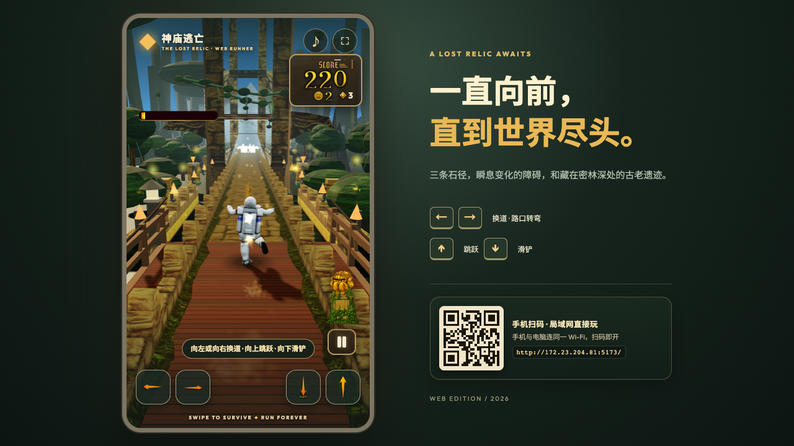
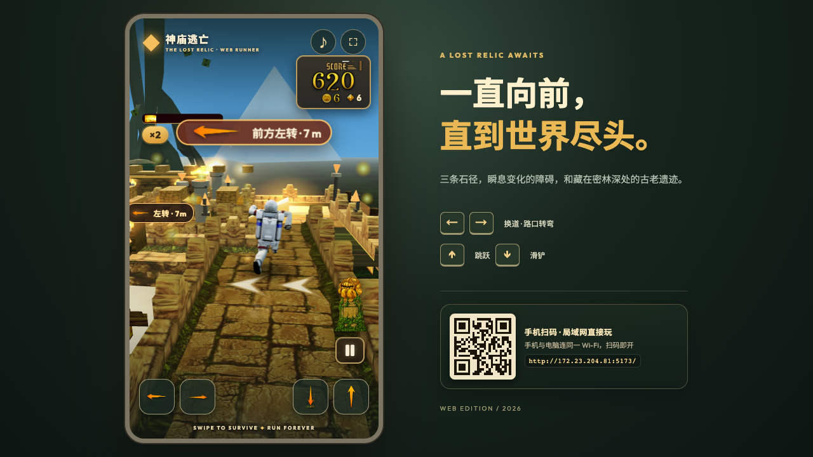
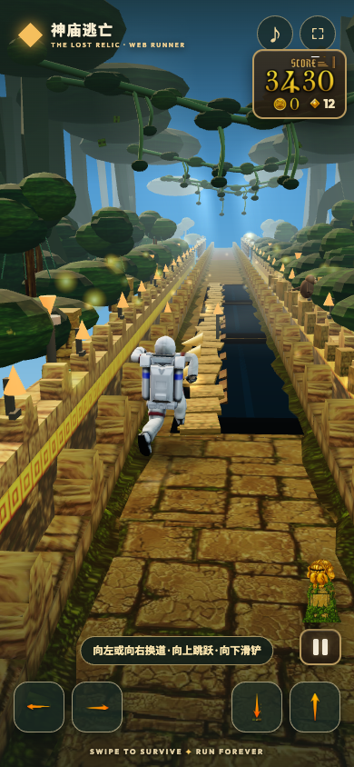

# Temple Run · Web Edition

[](https://github.com/malcolmyu/temple-run/actions/workflows/ci.yml)

用 Three.js 复刻的原版 Temple Run 1.39（Unity）网页版，并保留工程内的原版资源（骨骼角色、路面/转角/障碍 mesh、UI 图集、音效等）。

- 玩法：三条石径奔跑，左右换道 / 上下跳跃滑铲 / 路口转弯，收集金币与宝石，磁铁 / 加速 / 护盾 / 金币加成、金币倍率、断桥窄路坠崖、猴子偷金币、追逐者等原版机制。
- 资源：角色为原版 skinned mesh + 骨骼动画重定向；路面/墙体/门楣/障碍取自 APK；UI/音效/死亡插画为原版素材。
- 兼容：桌面键盘、触屏滑动/点按、倾斜换道（移动端）；局域网手机可扫码直连游玩。





## 运行网页版

```bash
npm install
npm run temple:dev -- --port 5173
# 浏览器打开 http://localhost:5173（TypeScript + ECS + Vue 重构版）
# 旧版（完整玩法，保留对照）：http://localhost:5173/legacy.html
```

构建：

```bash
npm run temple:build   # 产物在 target/temple-run/dist
```

## 在线版

- v2（TypeScript + ECS + Vue）：<https://malcolmyu.github.io/temple-run/>
- 旧版对照：<https://malcolmyu.github.io/temple-run/legacy.html>

GitHub Pages 使用 `gh-pages` 分支（Deploy from a branch）。重新发布：

```bash
tools/deploy-pages.sh   # 构建后 force-push 到 gh-pages
```

## 操作

| 输入 | 动作 |
| --- | --- |
| ← / → | 换道、路口转弯 |
| ↑ / 点击屏幕 | 跳跃 |
| ↓ / 下滑 | 滑铲 |
| 倾斜手机 | 换道 / 路口倾斜转弯 |
| Esc / 暂停按钮 | 暂停 |

## 仓库结构

```
target/temple-run/            # 游戏本体（web 前端 + 分析脚本/素材清单）
target/temple-run/web/
  index.html                  # v2 入口：TypeScript + ECS + Vue 3
  legacy.html                 # 旧版入口：完整玩法对照（src/main.js）
  src/main.ts                 # Vue 挂载
  src/game/                   # TS + ECS：world / components / game / path / render / terrain
  src/ui/                     # Vue SFC：HUD / 菜单 / 暂停 / 结算 / 商店 / 设置 / 二维码
  src/main.js                 # 旧版游戏逻辑（legacy 入口）
  src/runnerRig.js, sfx.js    # 两版共用：骨骼动画重定向、原版音效
target/temple-run/analysis/   # APK 逆向产物（rig json、贴图、清单、报告）
apk/                          # 原版 temple-run.xapk（分片，见 apk/README.md）
src/                          # 另一款小游戏「咩咩登峰」（Three.js 小羊登山）
docs/screenshots/             # 截图
```

## v2 重构（TypeScript + ECS + Vue）

默认入口 `web/index.html` 已切到重构版：Three.js 负责 3D 渲染，手写 ECS（组件 store + 显式系统调度）驱动玩法，Vue 3 渲染 HUD 与全部面板。旧版完整保留在 `legacy.html` 便于对照。

```bash
npm run temple:dev -- --port 5173   # / = v2，/legacy.html = 旧版
npm run temple:typecheck            # vue-tsc 严格模式
npm run temple:build                # 同时产出 index.html 与 legacy.html
```

首次打开 v2（或 v2 存档仍为默认值）会自动迁移旧版存档（`atb_temple_run_best` / `_chars` / `_stats` / `_settings`），只写一次 `temple.v2.progress`。

v2 与旧版的主要差异：转弯路口改用预铺的 12 m 广场补缝（不再让跨路口的瓦片斜穿另一条路）、里程碑恢复原版 NICE JOB / HIGH SCORE 图、新增动态局域网二维码（开发服务器 `/__lan-url` 提供 LAN 地址）。逐项对照与已知差异见 [target/temple-run/README.md](target/temple-run/README.md)。

## 地图场景（原版逆向）

按 XAPK 的 135 个 prefab 根节点还原地图族：神庙 / 木桥 / 断崖 / 柱廊 / 周年神庙；直道、A-D 弯、T 路口、半边路（NarrowLongLeft/Right）、长坑 A/B、火塔、塔门、树根跳/绊/滑铲、主题过渡帽。当前已接入：

- **半边路**：仅左侧或右侧半幅路面，缺失侧是深渊；左侧安全 0/1、右侧安全 1/2，最外侧车道坠崖；首个半边路在 87–111 m，另有每 12 tile 一次的 1 tile 短窄路。
- **原版障碍**：树根、倒木、火塔、短坑/长坑、石墩改用 APK 导出 OBJ；火塔中间车道安全，只能换道，不能跳。
- **主题**：神庙 / 木桥 / 断崖 / 柱廊 / 周年神庙；周年神庙带金色旗帜，神庙段有塔门地标。
- **视觉**：按参考视频改为暗绿丛林、藤蔓/树冠、石拱、窄石道；主路视觉收窄，石路单独打暖光。护盾激活时角色显示蓝翼（视频里的永久翼是 mod，不照搬）。

完整 prefab 清单与实现状态见 [docs/original-map-catalog.md](docs/original-map-catalog.md)；路障清单见 [docs/roadblocks.md](docs/roadblocks.md)；参考视频分帧与 mod 说明见 [docs/reference-video-notes.md](docs/reference-video-notes.md)。

## 原版安装包

GitHub 单文件上限 100 MB，`temple-run.xapk` 以 75 MB 分片存放在 `apk/`，重组方式见 [apk/README.md](apk/README.md)。

## 原版机制对照（IL2CPP 逆向）

| 原版字段/资源 | 网页版实现 |
| --- | --- |
| 蓝色天空、干净转角 | 蓝色渐变天空 + 浅蓝雾；转角仅保留低墙/火盆/箭头 |
| `kObstacleTreeJump` | 树墩排（跳跃） |
| `kObstacleTreeSlide` | 倒木横杆（滑铲） |
| `AllowTiltToTurn` | 倾斜换道 / 路口倾斜转弯 |
| `AllowFallOnCliffs` `CanPathExtendOnSide` `kPathLevelCliff` | 断桥单车道 + 坠崖死亡 |
| `CoinMagnetMultiplier` | 磁铁能力 |
| `FootStepsCliff` | 悬崖脚步音 |

更多开发记录见 [target/temple-run/progress.md](target/temple-run/progress.md) 与 [target/temple-run/README.md](target/temple-run/README.md)。
