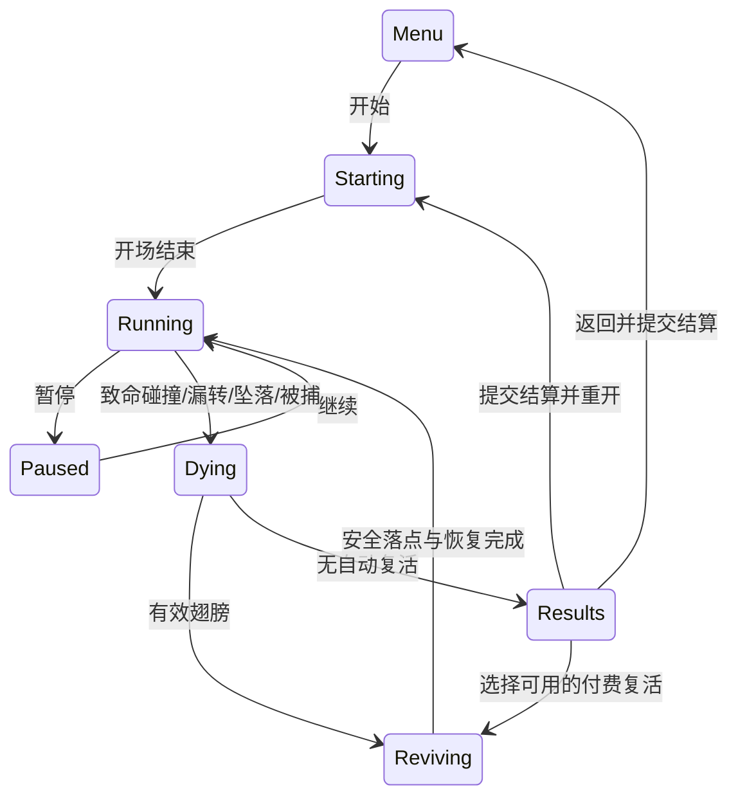
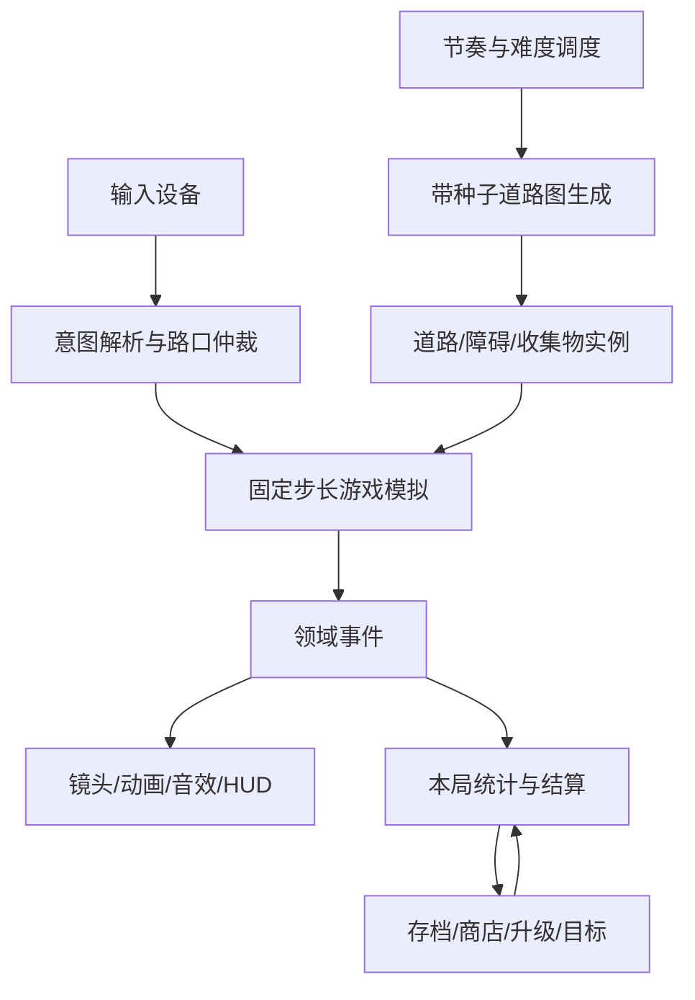

# 神庙逃亡：完整可玩版设计方案

版本：v2，2026-11-01。状态：完整元素与架构方案；当前beats-v7本地完整可玩版已按原始清单收口，见[交付结论](playable-delivery.md)。架构未来演进和真机边界单独保留。

实施进度见 [implementation-log.md](implementation-log.md)，具体证据见[玩法验收表](playability-acceptance.md)。当前已接入InputRouter/GameSession、本局升级快照、正常种子生成/节奏导演、动作与横移预检、障碍/支撑草稿发布、三主题、分路风险奖励、可变长窄路及安全侧金币、四种道具、死亡/双翼/宝石复活、结算/购买/升级/重开；有当前浏览器闭环与三分钟实时长跑证据。仍需补代表性视频道具全循环、真人手感/真机、部分原版生成来源与逐元素表现，不能把已实现或自动策略通过视为全部验收。

本方案依据 Minghao 最新方向：先设计完整游戏，再按功能推进。参考视频用于提炼操作、决策、节奏和具体元素；正常模式不复制某次录像的道路顺序、死亡时间或分数时间线。此前逐帧取证和原版逆向结果作为资料保留。

## 审计附录与人工反馈（2026-11-01）

[打开HTML审计附录](audit/index.html)：现存截图、视频采样、原方法反汇编、来源JSON、导出素材和复核脚本的可搜索索引，支持大图、页内源码与SHA-256核对。

最新人工试玩反馈为：前方有路却报撞墙、分路接近变平、未见半边缺路、黄色物体身份/造型不明。此前自动测试未覆盖或未暴露这些问题，整体体验仍待修复复核；不得用历史“已完成”结论否定反馈。普通试玩未开启完整trace，现存现场已保存，不能倒推本局死因。先提供附录供审阅，再按四项逐一复现和修复。Round137已从用户本机日志核实最后一次为漏转，并修复2～4m补转空档、分路选边地形跳变与跳跃/死亡脚步循环；半边路可见性及黄色物体身份仍待继续核对。

默认诊断：每局保留约20秒跑动/路面切口/障碍采样与最近100条输入，死亡时保存实际cause、位置/路口、镜头、附近地图及几何信息。仅存本机最近3次死亡，菜单/刷新后可从“统计→导出试玩日志”取出；结算页也可导出。它不是逐帧录屏或确定性回放，不需开启旧opt-in trace，也不补造此前未记录的试玩。

## 1. 游戏要让玩家体验什么

玩家自动前进，通过观察前方路况，连续完成转弯、横移、跳跃和滑铲；金币与道具使玩家在安全路线和高收益路线之间做选择。失误会产生绊倒、追逐压力或死亡。每局成绩和收益进入成长系统，支持升级、角色收藏和再次挑战。

核心不是让角色沿一条预定轨迹跑完，而是让玩家反复完成“看懂情况 → 选择动作 → 承担结果 → 获得反馈”。无尽模式没有固定终点；“完整玩通”指整套操作与失败、复活、结算、成长、重开闭环都成立。

设计支柱：

1. **操作因果清楚**：正常路段按左右就是横向移动；转弯只在真实路口生效。死亡必须能解释为可见的危险或漏转。
2. **程序生成可读、可解**：每段路至少存在一条当前能力可达的生存路线，不能依赖未获得的护盾或加速。
3. **风险与收益并存**：金币路线引导动作，也允许放弃；分支产生真实选择，不能只是装饰。P3-3已加入两臂独立金币/宝石选择；P3-5正常模式1000进度后加入安全臂5币与火墙风险臂9币/宝石，入口提示、支路碰撞与奖励绑定同一臂，均为网页规则假设。
4. **变化形成节奏**：直路、组合障碍、转弯、主题变化和喘息段交替，长跑不等于重复同一小段。
5. **每局留下进展**：结算可信、存档稳定、购买有效；局外系统服务跑动体验。

## 2. 参考与证据边界

| 资料 | 用途 | 限制 |
|---|---|---|
| [短跑参考 BV1ypuKzPErT](https://www.bilibili.com/video/BV1ypuKzPErT/) | 开场、操作组合、树障碍、火塔、窄路、转角及石/木主题的可见形态 | 已有逐秒资料，但正常地图不能变成录像脚本；手势和短窗口不能从1秒采样精确推断 |
| [长跑参考 BV1de411T7Gs](https://www.bilibili.com/video/BV1de411T7Gs/) | 长时间循环、多主题变化、重复与变化比例、后期可读性 | 页面确认21:11；本轮播放器频繁缓冲，已核实早期60/720/1080/1265秒及初次约68秒画面；补充300/304/540/900/904/1200/1268秒的实际呈现帧，确认主题变化、保护外观、窄路与结算。Round114另补60–65.5/364.9–370.4/1264–1269.5秒三段连续解码，确认动作前后、保护外观和失败结算；仍非全片连续观察，不能据此恢复概率/后期难度；见[观察与失败记录](reference/BV1de411T7Gs-observations.md) |
| 原版 APK/IL2CPP 与资源 | 碰撞区域、动作、道具、计分、升级和部分生成约束 | 当前二进制版本未证明与两段录像版本相同；运行时远端配置、完整生成谓词仍不全 |
| 当前网页代码与回归 | 判断已实现、接口耦合与实际缺口 | 自动控制通过不等于真人手感达标；调试生成不能证明自然可达 |

后续所有规则标记为“原版代码证据 / 视频观察 / 本项目设计 / 待验证”。没有来源的数值必须成为明确设计参数，不能包装成逆向事实。旧资料中的“单段仅五枚金币”“固定速度”“唯一参考”等结论可能已被后续证据推翻，具体以当前代码与最近审计为准。

当前逐项验收状态与证据见[playability-acceptance.md](playability-acceptance.md)，按用户原始范围的交付核对见[delivery-audit.md](delivery-audit.md)。

## 3. 完整元素与玩家规则

### 3.1 操作、角色和追逐

| 元素 | 玩家行为与反馈 | 必须处理的边界 |
|---|---|---|
| 自动跑动 | 随进程提高压力；角色和前景反馈速度 | 暂停不推进世界；加速结束平顺回到正常速度 |
| 玩法说明 | 主菜单与暂停可查操作道路、障碍失误、道具成长三类规则 | 查看时阻断游戏输入；暂停中不推进世界；Esc返回，Tab焦点不落入后台按钮；护盾不自动转弯与加速自动转弯明确区分 |
| 左右移动 | 方向键/左右滑动选择相邻车道；A/D或经授权的倾斜提供连续横移 | 输入仲裁明确；最外侧重复按键限幅，不产生虚构撞墙；跳/滑中仍可横移 |
| 路口转弯 | 在进入窗口前看见出口，窗口内方向输入提交转向 | 路口方向与换道不能双重消费；T口两个方向均可；错方向或漏转有对应结果 |
| 跳跃 | 越过树根、缺口和允许跨越的火塔，空中可收高金币 | 起跳、落地和地面高度共用同一支撑模型；空中连按不无限起跳 |
| 滑铲 | 穿过拱门、树洞及允许滑过的火障碍 | 滑铲持续时间与碰撞盒一致；不能靠动画判碰撞 |
| 绊倒 | 非致命树根等失误让追逐者接近 | 恢复窗口可见；再次失误可被抓；保护状态与原版绊倒规则明确 |
| 追逐者 | 开场追出、绊倒靠近、恢复后拉开、被捕时接触 | 接地/跳跃/转角跟随不穿模；不作为无预警随机死亡来源 |

触摸适配器在pointermove越过18 CSS px时立即识别方向，松手不再重复动作；每个按下到松开只消费一次。取消未识别的手势会丢弃；已执行动作不能撤回。18px、单次手势与轻点跳跃为网页策略，原TouchMoved移动阶段识别有代码依据，不能与原默认49.5屏幕像素混为同一灵敏度。模态、blur、重开清除手势和输入队列。

方向解析器只返回一个结果：`ChangeLane / Steer / BufferTurn / CommitTurn / Ignore`。附近真实转角可暂存方向意图，普通左右事件不得直接触发 `Stumble` 或 `Death`。这是历史撞墙 bug 的长期不变量。

原版触摸不是一个已证实的固定6m窗口：Round126核实Sensitivity控制的转角图查询半径（构造默认换算19.8m），Round127补核GameInput.Update方向flag年龄仅在>1秒时清除。网页将附近下一合法转角的输入缓冲到1秒，以实际横向位置计算径向距离，不提前换道或旋转；到既有6m确认范围后才选出口，中心提交/后4m补转范围仍是网页几何适配（Round137将原2m延长到既有4m失败边界），并非完整原HandleDelayedTurning移植。错方向/远处输入仍换道，后续换道取消旧意图，T口采用最后预备方向；这些仲裁是网页策略。暂停冻结年龄，死亡/复活/重开/目标路口变化清理。当前输入规则版本turn-intent-v2；4m为用户试玩后修正的网页宽限，不冒称原版固定窗口。详见[分阶段取证](native-path-generation.md#转角查询与输入时序round126)。

### 3.2 道路与拓扑

| 类型 | 玩法作用 | 组合约束 |
|---|---|---|
| 石桥、木桥、悬崖/树根道路 | 材质、边缘、高差和可用障碍形成主题差异 | 主题不是单纯换贴图；连接帽、地面与支撑面匹配 |
| 左右转角 | 视线变化和方向反应 | 保留看见出口、输入和转后恢复空间 |
| T路口 | 真实左右出口选择 | 两臂都有有效后继；未选分支也不能改变已选路线随机序列 |
| 左右分路与合流 | 绕障碍、选择收益、持续保持侧向位置；地形始终固定，选边不能改变缺口 | 选择点、支路长度、合流位置清楚；从选中支路连续接回主路 |
| 断桥/短坑 | 单次跳跃时机 | 缺口与起落地面共同验算 |
| 长坑/成对桥帽 | 更高要求的起跳距离 | 低速不可跨时重新选片段，不能偷偷提高速度让它勉强可过 |
| 半边窄路、长窄墙 | 持续侧向保持，而非一次跳跃 | 以真实剩余支撑区域判定；长窄路用B帽/1–3块本体/A帽生成36/48/60m三档，持续保持安全侧，进出均留横移余量。原版兼容表允许本体重复，三档等概率为网页策略；金币按原支撑多边形逐枚验证，低金币串沿安全侧延伸；保留已有串间距/最大串门槛，不让窄路组件误触发普通障碍排除。金币不能强迫玩家跳到无支撑区 |
| 主题连接 | 节奏转换和高差处理 | 接缝不能是意外裂缝；需要跳跃时，提前提供可见的合法起跳区 |

### 3.3 障碍目录

每个障碍拥有独立的视觉资源、碰撞体、支撑面、合法动作和失败类型。

| 障碍 | 应有解法 | 失败反馈 |
|---|---|---|
| 高树根/横杆 | 跳跃，存在侧空位时可绕行 | 撞击死亡 |
| 低树根 | 跨越或绕行 | 绊倒并引发追逐压力，重复失误可被捕 |
| 树洞/拱门 | 滑铲或合法侧路 | 头部撞击 |
| 火塔 | 按真实高度/结构跳跃或滑铲 | 火焰撞击；保护是否有效按效果表判定 |
| 独立火墙 | 正常石桥中出现低火墙，跳过；站立/滑铲碰撞致死 | 已实现网页变体，复用原火焰贴图；原版独立类型与生成规则仍无确证 |
| 石墩 | 换道绕开，可跨越性以定义决定 | 撞击；当前行为部分是网页设计 |
| 窄墙/半边缺路 | 在安全侧通过 | 撞墙或掉落由实际接触位置区分 |
| 坑/断桥 | 在支撑允许处起跳并落地 | 坠落或落水 |

### 3.4 收集、道具与成长

- 金币：普通/高值金币、直排/侧排/斜排/转角/高低排。主要作用是收益、引导动作和风险取舍；不把每一串都设计成必须吃完。
- 宝石：单独的稀有收集与网页复活货币系统；其来源、价格和原版差异显式记录。
- 磁铁：金币真实飞向角色；影响金币收入和收集范围的规则分别配置，不直接吸取其他道具。Round130重新核实原StartVacuum与Update：磁铁分支不修改人物透明度，alpha由独立HasInvincibility路径驱动；不因录像拾磁铁后半透明而为磁铁新增透明或免疫。录像当时并存状态仍未知，见[外观来源审计](../target/temple-run/analysis/native-power-appearance/source.json)。
- 加速：明确开始、距离预算、自动转向/越险能力和结束阶段；结束附近不能立即生成无法反应的危险。
- 护盾/无敌：定义能抵消的危险类别、外观和到期预告，不能泛化成所有情况下都不掉落。Round132确认视频白色条带人形拾取→青色半透明与缺路蓝色网→恢复实体外观；Round133实际核实网页窄路帽/本体已注册为gap，现有网面会覆盖窄路缺失侧；自然左12m/右36m保护通过及到期隐藏已验证，撤回Round132静态误判。视频媒体时间差不作为持续时间参数。
- 金币奖励：即时奖励，不与持续金币倍率混为一类。
- 天使翼/永久翼：激活、有效期、库存、冷却、触发死亡后的复活过程完整；永久翼是本局消费品，不是永久无敌。
- 普通/超级起跑：使用窗口、库存、自动前进、安全过渡和收益记录明确。
- 计分：单局分数、世界路程、统计距离、金币收入、充能和目标倍率分别计算；HUD展示各自含义。
- 角色：收藏、预览、购买、装备、开跑加载。经典模式不通过皮肤制造隐蔽速度优势；挑战模式若保留差异要明确说明。
- 角色素材加载独立于购买：loading/ready/error状态在重开、回菜单时保留，失败明确提示临时替身，菜单/商店均可免费重新加载已装备角色；预览独立重试，不把预览成功当跑者成功。失败不删除所有权、不重复扣款，异步旧请求不得覆盖新选择。
- 商店/升级：显示价等于扣款价；余额不足、满级、已拥有、重复点击均无额外扣款；升级必须能在正常跑动中体现效果。
- 目标：操作挑战、生涯进度、收藏与道具目标；目标目录覆盖率只是内容指标，不能替代核心玩法验收。

## 4. 一局游戏的状态与结算契约

实现契约：

- 每局有唯一 `runId`；死亡序号与复活序号不创建新局。
- 开局通过RunUpgrades固定六类升级等级、道具资格、时长、加速预算、奖励与收入倍率；本局内不再动态读取商店全局等级。新等级在下一局生效，复活不重新捕获。档值沿用原规则函数，金币收入倍率保留已注明网页扩展。
- 暂存单局金币/宝石/成绩，只有最终退出本局才提交；结果页“结算并去商店”会先结束本局入账，再开放消费，关闭商店回主菜单。结果页复活入口在结算前保留；提交以runId防重。当前代码已有 `runCommitted`，迁移时保留此行为。
- 商店、升级、设置、统计、目标和玩法说明共用useModalDialog，限制面板内焦点、Esc返回并恢复入口；同时保留游戏Input阻断。两者不可互相替代：原生按钮的Enter激活不经过游戏输入队列，后台开跑/继续按钮不能通过Tab触及。
- 首次教学也使用同一焦点边界；取消回菜单且下次仍提示，只有确认开跑才记录已完成，避免教学背后再开商店形成叠层。
- 复活不重复结算、不清空本局成绩，不跨越未完成路口立即再死；选取当前支撑图上的真实安全点。
- 失败文案按实际致命接触对象区分树根、树洞拱门、火塔、低火墙和木桥横梁；文案属于网页反馈设计，不改死亡类型或解法。石墩/低树根保持绊倒语义，追逐者捕获仍报告捕获，不能伪造成撞击即死。死亡插画通过稳定deathCause选择：火塔/火墙使用原APK烧灼图，树洞/木桥横梁使用原低顶图，树根使用原撞树图；坠落/落水/被捕/漏转仍按死亡大类选择。死亡文案不承担类型识别，已据ImageData与场景Character数组接入Scarlett/Karma/Barry/征服者四组专用图及原表缺项回退；其他网页皮肤保持默认图，不猜原生身份。网页选择固定代表图，原版随机图/文案选择未完整移植。
- 复活表现：恢复可跑姿态、透明度/贴图、保护与加速反馈。原APK默认角色Animation完整引用仅Run/Jump/Slide Start/Slide Loop/Stumble，sharedassets0全45个AnimationClip未见独立复活片段；CharacterPlayer.Resurrect直接调用SetAlpha与ApplyPlayerTexture。故独立起身动画不是已确认原版机制，不因文档曾列“待补”而杜撰；其他包与程序化效果仍可核对。证据：[资源及方法审计](../target/temple-run/analysis/gameplay-revive-clip-audit.json)。
- 重开清空本局道具、充能、输入、计时、追逐压力和未选支路状态；保留库存、升级、已购角色与历史成绩。
- 旧档迁移必须一次性：新版真实保存后记录legacyMigrationComplete。余额花完、最后一件道具用完都不是重新导入旧档的理由；无标记的早期新版档仍用清洗后的全部库存/累计计数判断是否已有进展。仅真正空档继续兼容旧档导入，不删除旧键。
- 刷新/关闭的收益策略必须统一。第一阶段保留当前存档行为；持久化未结束局与断线恢复作为后续独立决定，不暗中更改。

## 5. 程序生成设计

正常运行保留玩家后240米的课程窗口，并保留路口/主题/片段前驱。CoursePlan.turnOffset维持绝对路口编号，障碍/奖励消费游标随前缀回收同步修正；CourseCoinDirector使用绝对turnAt。完整历史只在未启用回收的离线对照中保留，运行时调试course快照声明retainedFrom，不承诺从已回收快照重建全局历史。当前种子和随机流不因回收改变。

正常模式采用**带种子的道路图 + 片段语法 + 约束检查 + 节奏调度**。录像路线只留在开发回归模式中。

### 5.1 生成过程

1. 从玩家所在有向边出发，生成超过最远可见距离与最大决策距离的前向窗口；保留必要支路和合流。
2. 节奏调度器决定下一组的意图：恢复、单动作、横移、转向、组合、主题过渡或奖励机会。
3. 在主题和难度允许的片段中按权重选候选，过滤连接方向、占用网格、转弯间距和近期重复。
4. 放置障碍后计算可达动作序列；若不存在，有限次重试，最终使用安全直路。
5. 在可达路径及可放弃的风险路线布币；再放道具，避免遮挡危险提示或出现在不可达位置。
6. 固化节点ID和内容，进入渲染窗口；经过并超出回收距离后释放实体。

### 5.2 片段数据

`SegmentDef` 至少包含：主题、入口/出口端口、局部长度、支撑区域、可放障碍槽、允许动作、起落地窗口、视距要求、互斥标签、相邻限制、资源引用和来源标记。

`SegmentInstance` 至少包含：ID、父节点、分支ID、局部到世界变换、选择种子、已选内容和回收边界。同一内容不由渲染层再次随机决定。

片段长度分布与权重分表管理：`theme × difficultyStage × beatIntent`。已恢复的原版约束先保留；未恢复的权重作为本项目参数，不能从一段录像的频次直接推成真实概率。

### 5.3 可玩性约束

- 危险首次可见到必须行动之间的时间，至少覆盖识别、输入和动作启动预算。初版用可配置预算计算，真人试玩后再定参数；不把所有速度都套固定米数。
- 跳跃跨度验算覆盖当前最低可能速度、起跳余量、缺口和落地余量；护盾/加速只能提供额外解法，不能成为唯一解。
- 转弯入口和出口不能叠加互相矛盾的强制动作；窄路必须有连续安全侧。
- 分支至少两条真实可通路径；合流前不突然改变玩家横向位置。
- 组合障碍之间保留动作结束/切换空间；禁止只能依赖某一帧输入的组合。
- 所有候选被拒绝时生成安全片段，并记录拒绝原因，不能停更地图或生成死路。

### 5.4 随机性与难度

原版道路端口和占用匹配已恢复37种有效类型的开放方向，详见[连接契约](native-path-generation.md#道路开放方向与匹配契约round105)。端口是几何拓扑，不能直接作为玩家输入许可；普通左右仍换道，路口窗口内才转弯。候选兼容辅助方法已恢复39父枚举×4方向的156行原始矩阵，含坑帽/长窄路专用规则和构建方向性；状态过滤、组装后处理及网页别名/朝向适配仍未完成。

原版候选生成已补[静态控制流审计](native-path-generation.md)：类型1–37先做状态/方向过滤，再均匀选本次候选；部分类型额外随机过滤，长坑/过渡帽由其他组装路径处理。它不等于固定全局权重或完整道路长度分布；网页节奏权重仍明确为本项目设计。

候选选择后还有组装改写：原版在条件成立时同时把旧单格坑和新路块改为一对长坑帽，并分别保存OriginalPick/FinalPick。未来逐格适配须用旧块补丁+新块的整组事务，支撑/碰撞/布币预检通过后一次发布，不能只改渲染类型或只回退新块。详见[后处理取证](native-path-generation.md#候选后处理与双路块改写round112)。当前CoursePlan保留整组长坑生成与安全回退，不按录像强制排列。障碍/窄路/分路已改为局部Encounter草稿，动作/横移/结构预检通过后才写入正式数组，拒绝只清草稿再发布空恢复段；主题/路口元数据仍由原同步课程流程管理，不宣称任意异常下的全课程事务。

道路、障碍、金币、道具、装饰各用独立随机流。种子不是完整地图ID，后续内容还依赖实际进度与生成调用序列；详见[种子与重试契约](adr/seed-and-retry.md)。计划回放须记录种子、规则版本、本局配置、步长、输入消费阶段和UI命令，[记录层](adr/run-trace-format.md)已持久保存，完整播放器/重演校验与收益隔离仍未实现。视觉设置或截图次数不得改变下一段地图。分支随机流由稳定节点ID派生，未走分支的加载顺序不影响主路。

难度不是持续加速一个参数：分别控制速度曲线、反应预算、动作组合、横移距离、转弯频率、危险密度、喘息段比例和主题复杂度。原版已有进度门槛与快转状态可复用，但要由统一调度器决定，不再让多个模块各自加难度。

节奏初版采用“熟悉 → 单机制 → 两机制组合 → 恢复 → 主题变化”的可变顺序，不指定必须发生在视频第几秒。每种新危险先提供清楚的单独练习，后进入组合池。长跑阶段维持可读性，避免靠随机叠满障碍制造难度。

## 6. 软件架构与当前代码落点

| 模块 | 拥有的数据/职责 | 当前复用与迁移 |
|---|---|---|
| GameSession | 状态机、runId、暂停、死亡/复活、重开和系统顺序 | 从2566行 `game.ts` 提取；先封装现有行为 |
| InputRouter | 原始输入转意图、窗口仲裁、去重与输入缓冲 | 复用input/steering/turnInput；固定普通左右安全不变量 |
| RunnerSimulation | 速度、跳/滑、横向状态、地面支撑 | 复用nativeMotion/runner规则与已有ECS组件 |
| WorldGraph | 节点、端口、分支、合流、支撑区域、空间查询 | TrackGraph目前以克隆TrackPath实现支路，逐步补稳定边ID与真实后继关系 |
| CourseDirector | 难度、节奏状态、主题请求、内容可用性 | CourseDirector拥有独立随机流、练习计数、近期类型和压力计数；正常模式按主题/门槛加权选择并插入喘息，coverage bag仅fixture使用 |
| EncounterGenerator | 片段、障碍、金币、道具实例化前的可达性检查 | 复用catalog/courseCoins/nativeBonusSpawn；在生成前统一验证 |
| CollisionSystem | 持续路径上的碰撞/支撑检测，输出结果 | 复用原资源区域，给同一危险稳定ID防重复命中 |
| EffectsSystem | 时长/距离预算、吸币、保护、自动过弯与到期 | 复用powerEffects/nativeMagnet；与视觉解耦 |
| ChaseSystem | 追逐距离、绊倒恢复、被捕触发 | 复用native追逐规则，依赖事件，不独立篡改本局统计 |
| Presentation | Three.js对象池、动画、镜头、粒子、音效 | 从game.ts逐步移出；只消费模拟快照/事件，不决定可否通过 |
| Progression | 收益账本、价格、库存、升级、目标、迁移 | 复用progress/objectives，单一提交入口与版本迁移 |
| Replay & QA | 种子、规则版本、本局配置、步长、输入消费阶段、UI事件、死亡原因 | 现有浏览器脚本转为可复现用例，保留自然与诊断证据区分 |

脚步声以存活、接地、非滑铲/坠落且开场锁定结束为条件；跳跃立即淡停、落地恢复。暂停/死亡/离开实例清理循环。模拟任一阶段死亡后不再执行本帧后续跑动/收集；避免同帧重启音效。分路几何锚定基础路径，中央真实缺口和碰撞统一保留首尾6m连接区；这是网页分路适配，不是原算法声明。

统一数据约定：

- `worldMeters`用于几何，`runProgress`用于原版统计/预算，`simSeconds`用于模拟，`presentationSeconds`仅用于显示；变量名与接口明确单位，禁止混用。
- 采用固定模拟步长和有限补帧，渲染插值；原版受帧率影响的运动公式作为适配层处理，先建立现状回归，再改变步进方式。
- 事件至少包括 `TurnCommitted / PickupCollected / Stumbled / PowerStarted / PowerEnded / RunnerKilled / RunnerRevived / RunCommitted`，携带runId、tick和实体ID；音效和目标消费事件，不直接修改碰撞判断。
- 参数表与资源分离，所有新配置带schema与来源。测试或参考模式的配置不能泄漏到正常模式存档。

## 7. 当前实现的判断

已有可复用基础：三主题与多道路资源、跳/滑/转弯/横移、分路、原版碰撞区域、四类道具、金币行、追逐、死亡复活、结算、商店升级和大量回归。无需推倒重来。

后续架构演进与忠实度边界（不等于缺少核心玩法）：

1. `game.ts`同时管理输入、生成、规则、渲染和存档，修改一个细节容易影响其他环节。
2. 基线时CoursePlan硬编码开局153/321/489与四障碍。P2-1已将正常起点改为独立种子基础片段，固定前缀仅作显式fixture；P3-2已将正常后缀迁移为独立节奏选择，fixture保留coverage bag；风险收益分支基础已接入并实际验证，真人节奏验收仍未完成。
3. 目前多种距离/时间含义及frame推进相互关联，生成和手感缺统一的单位契约。
4. 生成前已接入encounterSafety统一入口，汇总路口余量、成对桥帽、动作恢复、横移通路、支撑跨度与分支冲突原因；同时拒绝重叠分路及整宽坑洞切口内的独立障碍/窄路/分路叠加（网页保守组合策略，桥帽可支撑边缘仍包含在切口包络内）；拒绝后清空该组障碍/窄路/分支并降为recovery。仍属保守分项契约，不是覆盖所有速度、跳跃和分支状态的完整可达性求解器；不能把200种子通过等同于所有地图均可达。
5. 局外目标连续补齐了目录，但不能替代真人操作、长程节奏和公平性验收。
6. 火墙原版身份/规则证据（网页变体已实现）、完整原版角色/价格、额外升级状态、原版完整生成权重、复活过程表现核对、真机倾斜仍有证据或实现缺口。

## 8. 实施路线与每阶段交付

| 顺序 | 交付 | 验收出口 |
|---|---|---|
| P0 设计基线 | 本方案、元素矩阵、来源与未决项、参考观察记录 | 所有用户要求的元素有归属、规则、状态和验收项；不以逐帧一致验收 |
| P1 输入与本局边界 | 提取InputRouter/GameSession；保留历史行为并修正不变量；runId结算契约 | 普通左右、双向转角、T两臂、跳/滑中横移、暂停、失败/复活/结算/重开全部实际操作通过 |
| P2 正常模式生成 | 固定录像开局移入显式reference模式；正常模式带种子从起点生成；片段约束检查/安全回退 | 多种子首局有变化，全部道路自然可达，无必死组合；固定种子与相同配置/进度调用序列可复现生成，完整操作回放仍待实现；真人能看懂危险 |
| P3 节奏与组合 | 分层难度、主题段落、风险金币、道具到期缓冲和连续长跑 | 新手能学会，熟练玩家有挑战；长跑不持续重复同组；保护结束不立即无解 |
| P4 成长收口 | 补最后目标、核对角色与商店经济、统一库存/复活/提交 | 购买→实际使用→失败→结算→升级→重开闭环；迁移与防重扣款/防重结算通过 |
| P5 元素表现与真机 | 逐元素形态/动作/音效/镜头，性能、触摸和倾斜 | 手机真机可玩；碰撞与视觉一致、对象数量有界；重要反馈不被特效遮挡 |

P1/P2优先于继续提高目标目录百分比。采用小步提取、同种子对照和逐系统迁移，每次只改变一类职责；已有原版规则与资源通过适配器接入。先不拆成多个服务，不引入与游戏规模无关的通用框架。

## 9. 整体验收

- 操作矩阵：左右/边缘/空中/滑动/持续横移，普通路和路口输入语义，键盘与触摸分别验证。
- 内容矩阵：每种道路、障碍、道具各有自然遇到记录，以及至少一个成功与相应失败用例；仅spawn截图不算自然覆盖。
- 生成验收：种子、规则版本和输入可复现；主题连接、分支合流、动作窗口、低速长坑、道具结束及回收边界通过自动约束和实际试玩。
- 闭环验收：不复活、翅膀复活、宝石复活、暂停恢复、结果退出、重开、购买、装备、升级、刷新存档分别检查。
- 长跑验收：多种子自动策略用于发现死路和对象泄漏；另做真人不加速试玩，记录误判、看不清和不舒服的时刻，不能用自动策略替代。
- 视觉验收：逐元素比较轮廓、材质、动作与碰撞的一致性；不要求同一秒出现同一片段或同一分数。

每轮报告固定四项：本轮完成的玩法/bug、规则来源或设计假设、实际验证和证据、仍缺什么。文档或目录接入不写成“全部完成”。

## 10. 后续需要定案的事项

1. 长视频已补中后段、青色半透明保护外观、右侧窄路及结尾结算的帧证据；已补三段代表性连续动作/结尾片段；完整道具取得到结束循环和全片节奏仍未核实，不拿缓冲/旧画面填时间点。
2. 正常模式采用本方案的可读性/公平性设计；若原版存在可证实的特殊行为，决定是否保留，并写明玩家理由。
3. 道路权重/长度和反应预算需要原版证据与试玩数据共同决定，当前不虚造一套“真实概率”。
4. 宝石复活、兼容金币价值升级和网页角色库是否保留为产品设计，与原版忠实还原分别记录。
5. 部署、公开发布和外部操作不属于本方案本轮交付；继续在现有本地实现上推进。

## Round138：试玩问题修复与规则边界

半边路首次教学采用网页策略：短段300m、长段800m后，在石路主题优先展示尚未练习的类型，恢复段仍优先。seed1实测首段约649m（旧版约1904m）。原版真实首次展示门槛/概率尚未恢复。窄路实体继续使用已有原生prefab与支撑区域，未用装饰平面伪造缺路。

分路去除网页金色圆锥箭头，由缺口与安全侧金币引导。石墩原文件为火塔片段派生资源（obstacle-manifest.json记录），现改为与单车道碰撞体一致的石质块；它是玩法适配，不能标作独立原生石墩。用户所述黄色物体缺少截图，无法唯一确认，已同时消除上述两个混淆来源。

验收证据：gameplay-narrow138-after.json/png、gameplay-pedestal138-after.png、gameplay-roads138.json、gameplay-inputs138.json、gameplay-feedback138.json、gameplay-modal138.json、gameplay-blocker138.json。前轮漏转窗口、静态分支地面和脚步生命周期修复保留。
