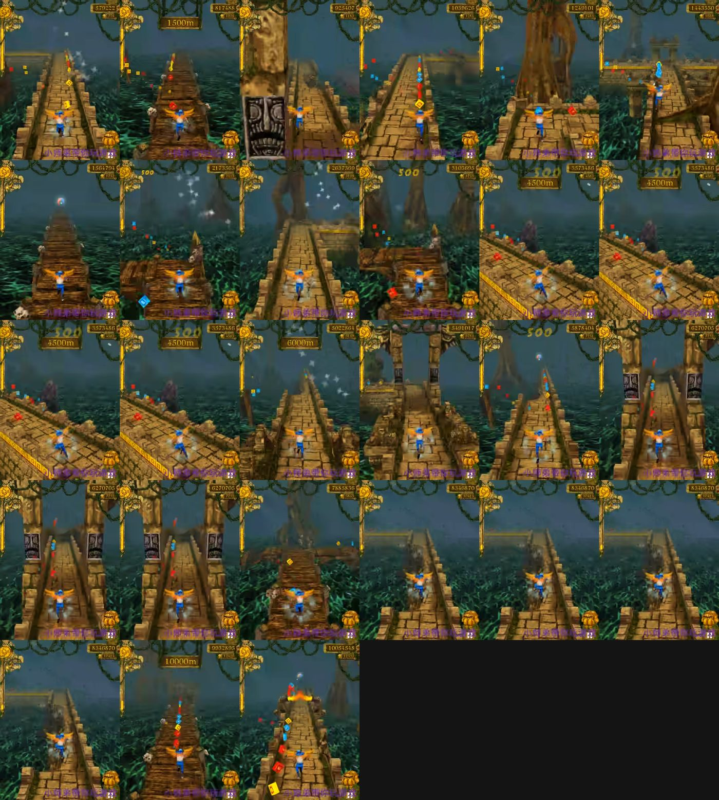
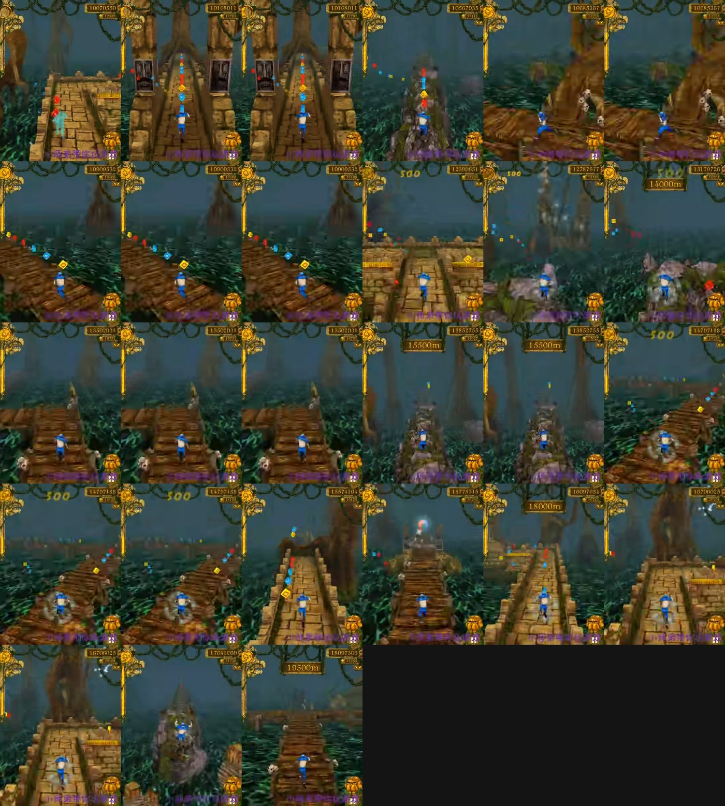

> 2026-10-31：本文针对旧参考 BV1GW411N794，不能作为用户新指定 BV1ypuKzPErT 的验收依据。新分析及逐秒证据见 [BV1ypuKzPErT 分析](reference/BV1ypuKzPErT-analysis.md)。其中永久翼、最高倍率、单车道等旧结论不得直接移植。

# 参考视频分帧记录

- 视频：<https://www.bilibili.com/video/BV1GW411N794/>
- 标题：神庙逃亡（Temple Run）1亿分达成
- 时长：1:02:24；cid 40713866
- 采样：用 Chrome 播放器 canvas 抓帧，0–60 s 每 2 s，之后 150/180/240/300/420/600/900/1200/1800/2400/3000/3600 s
- 原始帧与拼图：`docs/screenshots/ref-video/`（`contact-close.jpg` 是 0–60 s，`contact-mid-0/1.jpg` 是 60–1200 s）

## 先给结论：这是 mod / 加速跑，不是干净原版

暂停菜单（0–2 s）显示：**Distance 37 m，Score 2,581，Multiplier 63×**，角色带永久蓝翼；5 min 时已经 9800 万+，10 min 后画面长期停在 **7500 m / 1.16 亿**，最后 50 min 基本重复。原版倍率上限是 5×，翅膀是复活/道具效果而不是常驻。

因此：

- **不能**把 63×、1 亿分、7500 m 后停滞、永久翅膀当作原版机制/数值；
- **可以**把画面、场景、道路形态、障碍物外观当作视觉参考；
- 机制清单仍应以 XAPK prefab / IL2CPP 字段为准（见 [original-map-catalog.md](original-map-catalog.md)）。

## 60–1200 s 追加抽帧（每 10 s）

这段更能说明问题：20 min 内基本是**单车道直线**，没有正常的 90° 转弯、三车道换道或半边路坠落；角色蓝翼常驻，分数从 9800 万涨到 1.95 亿，路径由石桥/木桥/树根隧道/石拱交替组成。它更像**单车道直跑 + 永久翼 + 高倍率的 mod/改版**，不是原版完整关卡循环。

## 画面里能确认到的内容

| 时间 | 画面 | 对应机制 |
| --- | --- | --- |
| 0–2 s | 暂停菜单，37 m / 63× / 0 金币 | mod 菜单，数值不可信 |
| 4 s | 单车道石桥穿过大型石拱门，角色蓝/橙双翼 | 窄路 + 塔门 + 翅膀（疑似常驻 mod） |
| 8–16 s | 石桥贴着深色丛林，左右是藤蔓/树冠；桥面只有一条 | 单车道窄桥、暗绿丛林 |
| 20–40 s | 木板桥、石墙、树根形成的隧道/门洞 | 木桥主题、树根障碍 |
| 40–60 s | 石桥继续，金币成串，两侧常出现低墙/断口 | 窄路、金币、低墙 |
| 5–10 min | 分数暴涨，7500 m 后画面冻结 | 加速/录制问题，不可作为节奏基准 |

关键视觉差异：

1. **环境**：视频是暗绿丛林 + 藤蔓 + 石拱 + 深色雾气；当前网页版是亮蓝天空 + 浅色石墙 + 稀疏植被。
2. **路宽**：视频的主路基本是一条窄石桥；当前默认是三车道宽石路，只有半边路才收窄。
3. **门/拱**：视频里大型石拱门很密；当前 `tower-arch` 只是偶尔出现，普通门楣偏小。
4. **角色**：视频角色常驻蓝/橙双翼；当前角色无翼，只有复活图标。
5. **障碍**：视频能确认树根/石墙/断桥/木桥；当前已换 APK OBJ，但树根尺度和遮挡还需要按画面调。

## 当前实现 vs 视频

| 项目 | 视频 | 当前网页版 | 结论 |
| --- | --- | --- | --- |
| 半边路 | 单车道窄桥 | 半幅 2 lane 安全（左 0/1、右 1/2），提前 32 m 提示；视频单车道太苛刻，按可玩性保留两条 | ✅ 视觉对齐 |
| 原版障碍 | 树根/石墙/断桥/木桥 | 已用 APK OBJ（tree-jump/trip/slide、pit、flame、tower） | ✅ 资源对齐，尺度待调 |
| 暗绿丛林 | 主视觉 | 亮蓝天空、稀疏植被 | ❌ 差异最大 |
| 窄路比例 | 主路也偏窄 | 默认三车道宽 8 m | ❌ 需要视觉/数值决策 |
| 石拱门 | 密集出现 | 偶尔 tower-arch | ❌ 需要提高密度 |
| 翅膀 | 常驻（mod） | 无 | ⚠️ 不应直接复制为常驻 |
| 倍率/分数 | 63×、1 亿（mod） | 最高 5×、正常计分 | ✅ 保留原版机制 |

## 视觉重做进度

已开始 A 方向：暗绿丛林天空/雾/光照、树冠与藤蔓、窄石道视觉、密集石拱、暖色石路；护盾激活时显示蓝翼，而不是永久翼；半边路保留半幅 2 lane 以控制难度；机制仍按 APK 原版。

## 建议的两种对齐方向

**A. 按视频做视觉重做（推荐先做）**

- 把天空/雾/光照改为暗绿丛林；加树冠、藤蔓、萤火虫，压暗石路；
- 主路视觉收窄，补密集石拱门；
- 翅膀作为“护盾/复活/稀有道具”出现，而不是永久；
- 保留 APK 原版的三车道、5× 倍率、障碍规则。

**B. 只对齐机制，保持原版亮色神庙**

- 继续用 XAPK 原版亮色参考，不追视频夜景；
- 只补 T 路口、短窄路、树根绊倒等剩余机制。

视频本身是 mod，建议选 A 做画面、机制仍按 B 的原版清单，两边不混。
