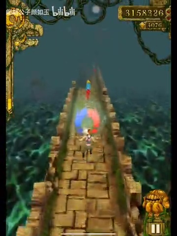
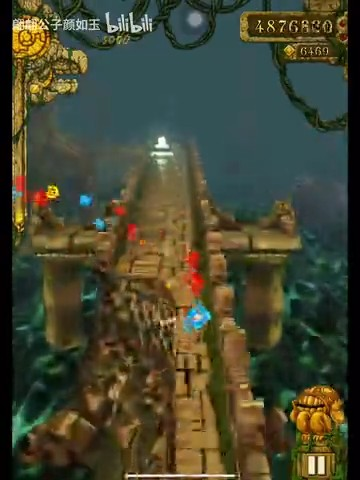
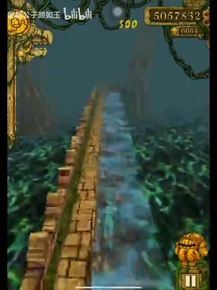
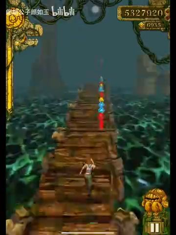

# 长跑视频观察：BV1de411T7Gs

2026-11-01，服务于[整体游戏设计](../game-design.md)，不是逐帧复刻验收。

来源：[【等待放假】神庙逃亡44000米](https://www.bilibili.com/video/BV1de411T7Gs/)。浏览器页面可访问，播放器duration为1271秒（21:11）。网页文本读取工具无法打开，实际通过Chrome播放器观察。

## 本轮确实观察到什么

- 页面初次加载在约68秒，video.readyState=4；可见女角色、木桥T形交汇、水面、远景巨树。只据画面确认结构，不从该截图推断两条出口的完整后继或转弯输入。
- 定位60秒后收到seeked，readyState=4，暂停状态保存完整画幅截图。可见木桥直段、前方转折与金币、女角色背后视角、左侧充能装饰和右上分数/金币；水域与稀疏树木使道路边界可见。
- 初次8秒超时后，稍后复查1265秒（21:05）readyState=4并保存截图：半边缺失的窄石路、角色在空中、前方树根；只确认形态，不能凭单帧判断该跳跃是否成功。
- 720秒（12:00）以更长等待重试，收到seeked且readyState=4，截图可见木桥转角与角色朝向变化。
- 1080秒（18:00）在初次20秒超时后再次核实readyState=4并保存截图：岩石/藤蔓包覆的第三类道路、转折、黄红蓝金币排列；支持把第三主题作为结构与素材变化，而非石桥换色。
- 这些帧支持“主题、道路、金币路线和镜头需要作为整体可读性设计”，不支持从单帧推断掉落权重、输入窗口或速度曲线。

## 缓冲与未验证内容

原1080P高码率频繁缓冲。尝试通过播放器选择360P，但播放器提示切换失败，最终不能把清晰度标签变化当切换成功。定位180/420/720/1080/1265秒各等待seeked至8秒上限，初次均readyState1，未作为有效时间点保存截图/得出玩法结论；后来720/1265成功另记；420/1080各延长至20秒仍超时，1080又在稍后复查成功，均保留原记录。

早期约10秒定位也未确认解码，保存的buffering-attempt-unverified.png仅为失败过程记录，不能作为时间点证据。

本轮不声称完整观看21分钟，不把加载中的旧画面标成后段截图。后续继续观察时必须先确认seeked和可解码状态；代表片段还要连续播放，确认动作与前后关系。需要补：代表片段连续播放、中后段主题/障碍组合、道具循环、节奏变化和最终结算。截图足够说明形态，完整运动/概率仍需更多证据。

本方案同时依赖已有短跑视频271张核实采样和原版代码/资源；缺失的长视频观察不以想象填补。

## 后续成功取样

逐次成功/超时记录见同目录sampling-audit.json，超时记录不被成功重试覆盖。

## 补充观察：中后段与结算（2026-11-01）

本次播放器先短暂显示“无法播放媒体”，随后恢复。清晰度按钮显示360P，实际媒体尺寸360×480。首次300/540秒寻址曾readyState1/seeking=true，等待同一次寻址完成后才继续；没有用缓冲帧补样本。

更重要的是，单看currentTime与seeked不足以保证截图已更新：初次1270秒截图出现此前游戏画面，不能作为结尾证据。最终接受样本均以requestVideoFrameCallback的mediaTime确认接近目标，再等待画面提交；1270秒没有取得匹配呈现帧，予以排除。原始尝试与最终核实并存于[sampling-audit.json](BV1de411T7Gs/supplement/sampling-audit.json)。这是取证正确性，不是恢复逐帧校准验收。

| 目标位置 | 实际呈现帧秒数 | 可见事实 | 不据此推断 |
|---|---:|---|---|
| 300秒 | 299.976 | 木桥、红蓝黄金币排、门柱/连接构造、5500米里程牌 | 不从单帧确定门柱的碰撞类别或金币飞行力 |
| 304秒 | 303.976 | 石桥、前方T口、右侧金币列与路外金币、短数字弹出 | 与300秒共同支持木/石连续切换；不据4秒差恢复段长概率或奖励公式 |
| 540秒 | 539.976 | 木桥前方横向分叉、侧向金币排、14500米里程牌 | 不宣称左右两路均被玩家走过 |
| 900秒 | 899.976 | 悬崖/岩石主题、连接构造、白色星状效果 | 不仅凭效果认定当时收集的道具或无敌能力 |
| 904秒 | 903.976 | 同类岩石路上的青色半透明角色，前方转角 | 支持保护状态需要可辨外观；不据单帧确定保护可穿哪些障碍 |
| 1200秒 | 1199.976 | 长半边窄路、安全侧在右，前方T口；无金币也需持续保持侧向位置 | 不把该路段绑定到正常游戏20分钟时序 |
| 1268秒 | 1267.976 | 成绩卷轴，成绩17263948、距离43880米、金币21231、分数加成×52，带“再来一次”“菜单” | 只确认该录像结尾的结算字段，不调整网页公式去匹配数值，也未观察到点击按钮后的重开 |

已核实PNG位于[supplement目录](BV1de411T7Gs/supplement)。新证据支持设计中：主题连续变化、风险金币/可放弃路线、持续靠侧窄路、状态外观、独立结算字段与重开/菜单出口。现有网页功能已覆盖这些类别，但视觉/状态反馈仍须逐元素检查。

边界：本次是离散代表画面与两个相邻时间点，未完整连续观看21分钟。没有据此恢复生成权重、完整道具循环、最后一次死亡的碰撞原因或原版经济；未辨认独立火墙不等于证明视频没有火墙。后续优先验证保护状态与动作反馈，保持规则来源标签，不回到像素/分数/顺序一致验收。

## 连续片段补核（Round114，2026-11-01）

播放器页面最初仍短暂显示“无法播放媒体”，随后video.readyState=4，实际媒体360×480。没有把错误遮罩当作影片画面。此次使用正常playback与requestVideoFrameCallback连续解码，每0.5媒体秒留一张观察图；不是逐帧对齐或下载视频。审计见[continuous114-audit.json](BV1de411T7Gs/continuous114-audit.json)。

| 实际片段 | 解码回调/观察帧 | 能确认的前后关系 |
|---|---|---|
| 60.00–65.50s | 166回调，12张样本 | 木桥高低结构与断口连续接近；61秒附近、65秒附近有明显视角转向；62.5/64.5秒可见腾空姿态，后续画面继续跑动。侧排/高低金币与道路共同提供方向线索 |
| 364.87–370.39s | 166回调，12张样本 | 石桥转向、塔门、半边窄路和多色金币连续出现；角色半透明并有星状拖尾。只确认保护外观，不能单凭外观区分道具类型/剩余时间；367秒附近可见腾空后继续跑动 |
| 1264.00–1269.49s | 157回调，12张样本 | 角色在窄路附近腾空，后续恢复跑动，随后失败并展开结算。结算可见角色专用死亡插画（Round116核对为GirlTree，撤回早先烧灼分类）、分数/距离/金币/倍率及“再来一次/菜单”操作；录像没有在本片段点击重开，不能把按钮存在当成已验证视频内重开 |

### 对设计的影响

- 继续以“看路况—选择动作—通过或失败—得到反馈”组织玩法；短的组合片段也能容纳转向、腾空和路面变窄，不应按某个视频时间表锁定生成。
- 金币路线应与真实支撑相容，并区分高低位置；不能只复用视觉横坐标而把币放到缺路处。当前安全侧布币已有Round110实际验证。
- 死亡反馈应由具体DeathCause与已核实角色共同驱动。Round114曾把结尾红色插画误判为烧灼；Round116从ImageData、角色表和原图核对，确认其为deathIllustrationGirlTree。撤回该火焰分类，不能按颜色猜死因。当前火类烧灼图的来源独立见APK Burnt资源，不以此段录像作依据。
- 本视频结算显示52×，只记录录像显示，不能据此重做网页分数时间线，也不能沿用旧笔记“超过5×必为修改版”的判据。

这是三段代表性连续观察（约16.5秒媒体时间），不是完整观看21分钟；全部道具的取得→持续→结束循环、手势、精确反应窗口和完整随机分布仍没有视频证据。半秒采样仍可能漏掉短动作，不能从缺帧推断某动作没发生。

Round115补充：后续扫描APK独立哈希资源找到了deathIllustrationBurnt@2x及角色变体，先前“六张已导出图没有同款”只是导出范围限制。当前网页已接入该APK的经典烧灼图和稳定deathCause；本录像结尾的红色图在Round116确认是GirlTree而非烧灼，撤回此前按红色外观作出的分类，见[资源证据](../../target/temple-run/analysis/native-burn-result.json)。

Round116：ImageData中kDeathTypeTree/character1指向deathIllustrationGirlTree@2x.png；场景Characters[1]为girl_Export1_prefab。该原图与末段卡片外形相符，网页Scarlett现已使用同类原图。图像身份不用于倒推影片中未记录的手势或精确碰撞输入。

## 道具外观连续过程（Round117）

正常播放345.00–390.03秒，共1349次解码回调，每约1媒体秒留样，46张递增画面。审计为[continuous117-audit.json](BV1de411T7Gs/continuous117-audit.json)，四张联系图为continuous117-0..3.jpg。没有下载媒体，也未进行逐帧对齐。

- 345–354秒：人物可见实体外观，木桥转石桥，多色金币、高低断口与转角交替。
- 355–356秒：前方彩色光球逐步接近人物；357秒样本中光球已不在原位置，人物出现半透明外观。Round124更近的连续片段已辨认其为红蓝U形磁铁；相邻外观变化不能证明磁铁给予保护，不能把这段当成护盾拾取证据。
- 357–379秒：多张画面持续呈现半透明人物，同时经过石桥、木桥、转角及窄路；期间可见腾空动作。不能仅凭通过画面判断玩家输入、自动控制或免疫类别。
- 380–390秒：人物重新呈现实体外观，继续跑动。374秒附近又有远处发光物体，不能据此排除中途其他道具影响，因而不把357至380的时间差当成原版持续时间。

星状效果在350秒、人物变半透明之前就已出现，因此“有星星”等同“某一保护道具生效”的判据不成立。本轮确认外观进入、持续、恢复的连续关系，仍不确认光球的道具名称、等级、碰撞豁免或完整状态叠加规则。原代码与网页自然拾取测试仍是机制判断依据，不按这段录像反调持续时间。

## 道具图标身份补核（Round124）

正常连续播放355.50–357.39秒，58次解码回调、20张约0.1秒观察图；[审计](BV1de411T7Gs/detail124-audit.json)记录实际mediaTime，而非按currentTime使用缓冲旧帧。此次仅辨认元素形状，不恢复逐帧流程校准。

356.01与356.11秒可清楚辨认红蓝U形磁铁；356.21秒已不见原图标。图标与原APK pickupVacuum.png轮廓相符，左右颜色次序可受平面朝向/映射影响，不据镜像认成另一类型。原护盾pickupInvincibility.png是条带人形，原加速为橙色跑者，金币奖励为圆形金币图案。四prefab中各自只有对应sprite名称，原prefab SHA与导出PNG尺寸/哈希已重新检查，见[native-pickup-identity124.json](../../target/temple-run/analysis/native-pickup-identity124.json)。

Round117“名称未知”在该光球上已被更新为磁铁；半透明外观的原因仍未知，不能据相邻时刻给磁铁增加无敌能力。当前APK StartVacuum只设置独立时间/flag，StartInvcibility使用另一组时间/flag，二者可并存；不据此证明录像当时一定并存，也不从这段恢复等级/时长/远端配置。网页保持原有独立机制，玩法说明新增原图与作用区别。

## 磁铁与人物透明度的原代码交叉核对（Round130）

[静态审计](../../target/temple-run/analysis/native-power-appearance/source.json)从当前APK元数据解析CharacterPlayer的HasInvincibility(0x154)、InvincibilityTimeLeft(0x158)、HasVacuum(0x16c)、VacuumTimeLeft(0x170)，并重新从原库导出/校验四个完整方法哈希、18处关键指令。

- StartVacuum仅五条指令：写磁铁时间、磁铁标志、清拾取年龄，返回；没有设置材质或透明度。
- Update在0x129733c读取HasInvincibility，false分支在0x1297514选alpha1；true路径通常选alpha0.5并在剩余2.5秒时循环淡出。0x1297520调用SetAlpha之后，才到0x12975b0独立处理HasVacuum计时。
- 无敌失效清标志并调用ApplyPlayerTexture，后者尾部SetAlpha(1)。不能把磁铁计时分支解释为改变透明度。

结论只覆盖该二进制这些路径：网页保持磁铁与无敌/透明状态独立是有依据的，不因视频相邻帧给磁铁补透明材质或免疫。视频357秒外观的实际状态仍未知；可能另有并存效果，但没有状态数据就不能认定具体原因。版本、远端配置和修改客户端亦未排除。这比“磁铁不一定无敌”的观感判断更强，但不是对录像状态的完整还原。

[负向控制](../../target/temple-run/analysis/native-power-appearance/negative-control.json)在临时库副本改无敌条件分支为NOP，审计拒绝且原库SHA不变。当前网页无敌材质/恢复与原道具测试通过，本轮未改生产机制或重新试玩。

## 护盾取得、保护路面与外观恢复（Round132）

[审计](BV1de411T7Gs/continuous132/audit.json)记录三个顺序正常播放片段：约390–420、420–450、450–478秒，中间暂停；前两段每约2秒留图、第三段每约1秒留图，再回看441–444秒每约0.1秒近景，共91张解码观察图。第二段875回调，第三段809回调，近景89回调；第一段原CDP等待3秒超时，但同一浏览器任务持续推进并暂停，随后取出16帧，未伪造其回调总数。不是无间断88秒播放，也不是完整看完21分钟。

- 441.976/442.276/442.576秒可见白色条带人形道具接近；442.876秒道具不再在前方，人物亮白，443.443秒人物呈青色半透明。形状与已核实原pickupInvincibility.png一致，区别于红蓝U形磁铁与橙色加速跑者。这里确认护盾外观取得过程，不根据相邻帧替代原代码机制判断。
- 455.643秒半边窄路的缺失侧有蓝色半透明铺面/保护网；461.443秒人物仍青色；465.310/467.243/469.243秒多处桥面断续位置可见蓝色网。既有原Safety Net素材/计时审计为其实现提供独立来源。
- 474.110秒仍见保护外观，475.076/476.043/477.010秒恢复实体人物并继续跑动/腾空。该片段可支持取得→持续可见→恢复的外观循环；没有全程状态flag、配置或输入记录，不能排除刷新/叠加，不将442到475的媒体时间差当原版持续秒数或将所有通过都判为免疫。
- 409.676/449.343等帧出现500数字，不据此认定为500金币道具奖励；未辨认金币奖励图标的拾取，不把数字弹出当另一道具完整循环。

Round132曾据“网面仅遍历gap/gapLong”推断窄路未覆盖，这是不完整的静态判断，Round133已撤回：自然窄路帽/本体实际注册为kind=gap、defId=narrowWall…，本来就在循环里。运行截图确实看到蓝色网面；左12m/右36m诊断护盾激活、缺失侧通行、自然失效隐藏及实际重开清理通过。见[11项运行证据](../../target/temple-run/analysis/gameplay-narrow-net133.json)。无生产修复，不应重复添加重叠网面。

## 下一段道具观察边界（Round134）

[510–550秒审计](BV1de411T7Gs/continuous134/audit.json)为正常播放、42张约1秒媒体呈现帧。510/519秒人物已有青色外观，529秒后恢复实体，说明本段起点不是一次道具取得前；不能把它当新的完整拾取循环。519.643秒500弹字不能证明奖励500金币。随后转向短片已有金币奖励图标线索，确认其只是经过未拾取（见短片Round134）；未找到加速/金币奖励完整录像循环，不补造。已有原代码/正常生成自然收集与到期专项仍是实现依据，额外录像片段属于继续完善的证据，不是新增强制交付项。
