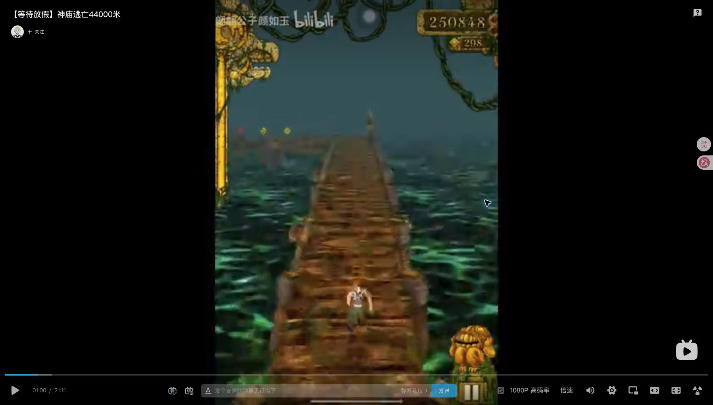
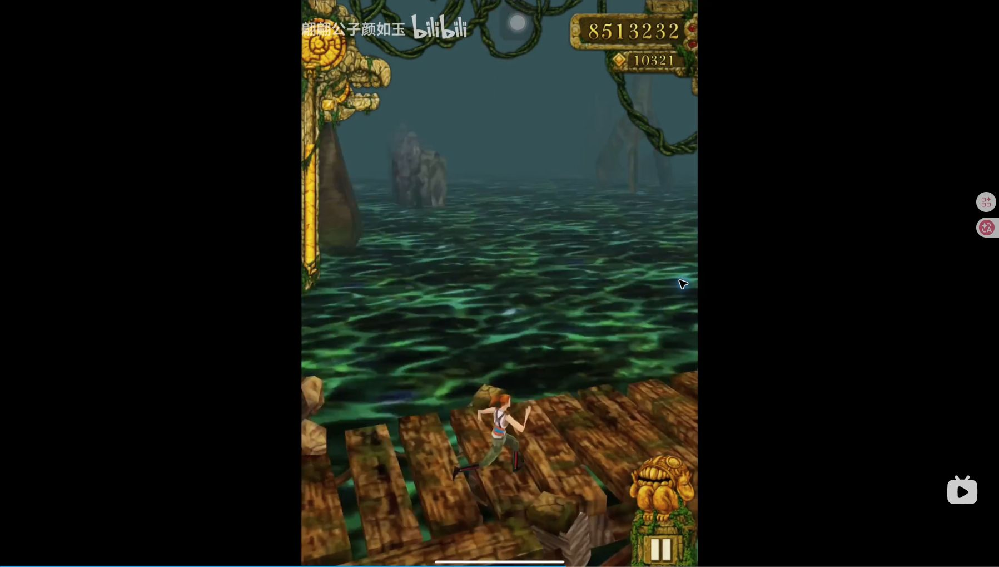
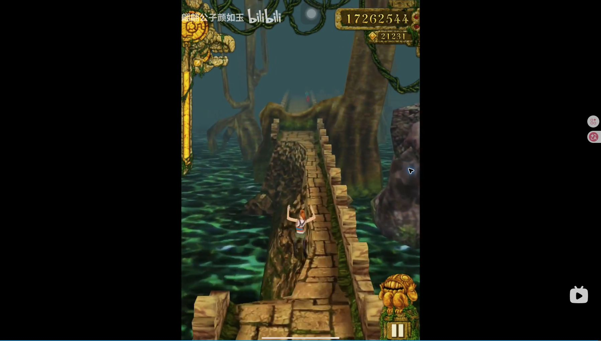
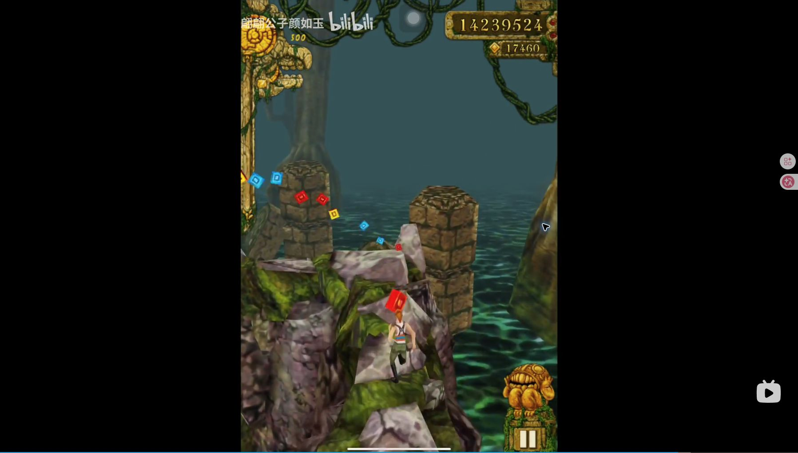

# 长跑视频观察：BV1de411T7Gs

2026-11-01，服务于[整体游戏设计](../game-design.md)，不是逐帧复刻验收。

来源：[【等待放假】神庙逃亡44000米](https://www.bilibili.com/video/BV1de411T7Gs/)。浏览器页面可访问，播放器duration为1271秒（21:11）。网页文本读取工具无法打开，实际通过Chrome播放器观察。

## 本轮确实观察到什么

- 页面初次加载在约68秒，video.readyState=4；可见女角色、木桥T形交汇、水面、远景巨树。只据画面确认结构，不从该截图推断两条出口的完整后继或转弯输入。
- 定位60秒后收到seeked，readyState=4，暂停状态保存完整画幅截图。可见木桥直段、前方转折与金币、女角色背后视角、左侧充能装饰和右上分数/金币；水域与稀疏树木使道路边界可见。
- 初次8秒超时后，稍后复查1265秒（21:05）readyState=4并保存截图：半边缺失的窄石路、角色在空中、前方树根；只确认形态，不能凭单帧判断该跳跃是否成功。
- 720秒（12:00）以更长等待重试，收到seeked且readyState=4，截图可见木桥转角与角色朝向变化。
- 1080秒（18:00）在初次20秒超时后再次核实readyState=4并保存截图：岩石/藤蔓包覆的第三类道路、转折、黄红蓝金币排列；支持把第三主题作为结构与素材变化，而非石桥换色。
- 这些帧支持“主题、道路、金币路线和镜头需要作为整体可读性设计”，不支持从单帧推断掉落权重、输入窗口或速度曲线。

## 缓冲与未验证内容

原1080P高码率频繁缓冲。尝试通过播放器选择360P，但播放器提示切换失败，最终不能把清晰度标签变化当切换成功。定位180/420/720/1080/1265秒各等待seeked至8秒上限，初次均readyState1，未作为有效时间点保存截图/得出玩法结论；后来720/1265成功另记；420/1080各延长至20秒仍超时，1080又在稍后复查成功，均保留原记录。

早期约10秒定位也未确认解码，保存的buffering-attempt-unverified.png仅为失败过程记录，不能作为时间点证据。

本轮不声称完整观看21分钟，不把加载中的旧画面标成后段截图。后续继续观察时必须先确认seeked和可解码状态；代表片段还要连续播放，确认动作与前后关系。需要补：代表片段连续播放、中后段主题/障碍组合、道具循环、节奏变化和最终结算。截图足够说明形态，完整运动/概率仍需更多证据。

本方案同时依赖已有短跑视频271张核实采样和原版代码/资源；缺失的长视频观察不以想象填补。

## 后续成功取样

逐次成功/超时记录见同目录sampling-audit.json，超时记录不被成功重试覆盖。

