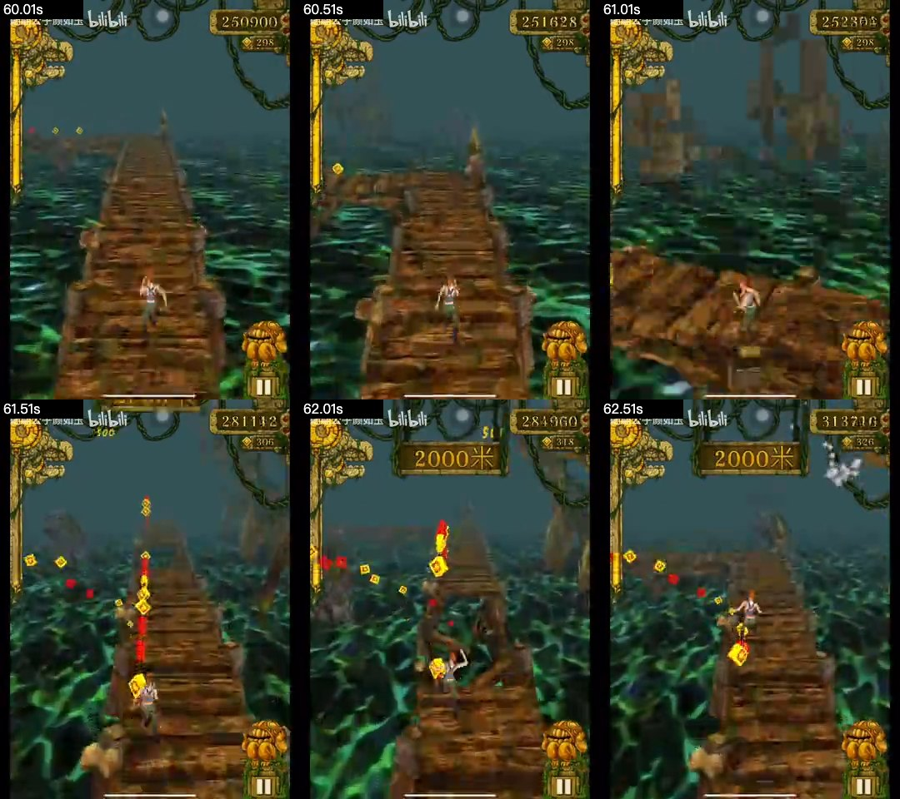
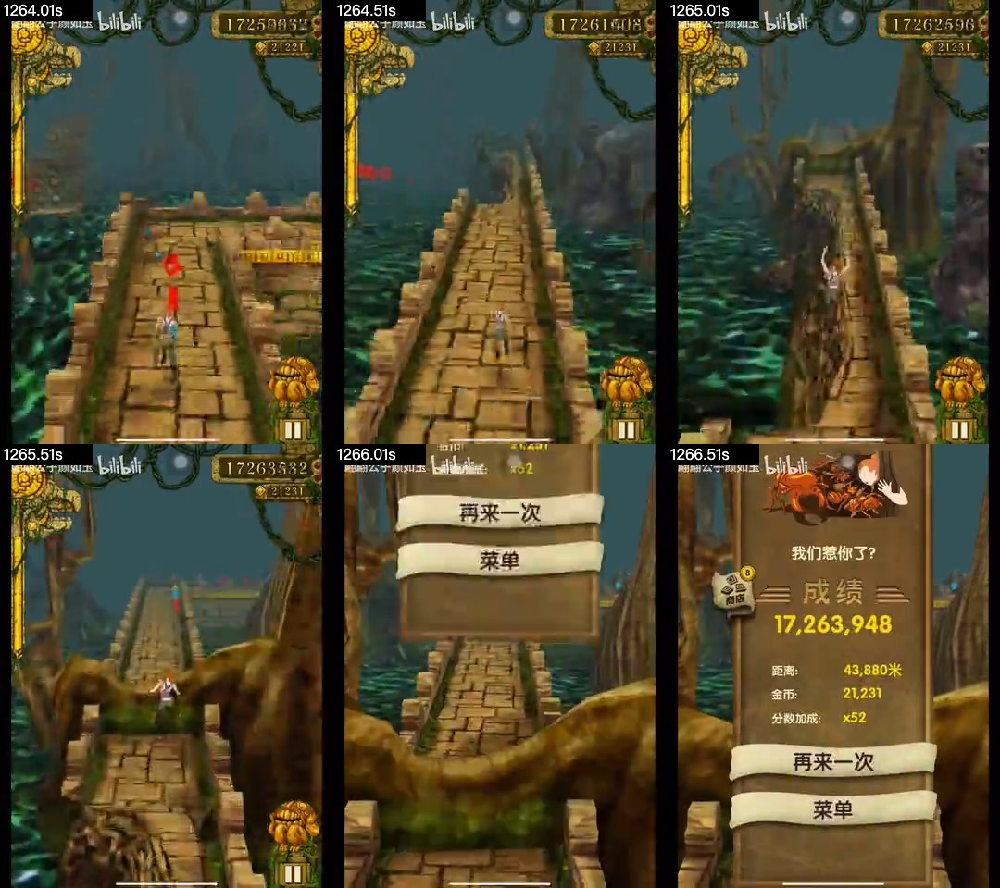

# 长跑视频观察：BV1de411T7Gs

2026-11-01，服务于[整体游戏设计](../game-design.md)，不是逐帧复刻验收。

来源：[【等待放假】神庙逃亡44000米](https://www.bilibili.com/video/BV1de411T7Gs/)。浏览器页面可访问，播放器duration为1271秒（21:11）。网页文本读取工具无法打开，实际通过Chrome播放器观察。

## 本轮确实观察到什么

- 页面初次加载在约68秒，video.readyState=4；可见女角色、木桥T形交汇、水面、远景巨树。只据画面确认结构，不从该截图推断两条出口的完整后继或转弯输入。
- 定位60秒后收到seeked，readyState=4，暂停状态保存完整画幅截图。可见木桥直段、前方转折与金币、女角色背后视角、左侧充能装饰和右上分数/金币；水域与稀疏树木使道路边界可见。
- 初次8秒超时后，稍后复查1265秒（21:05）readyState=4并保存截图：半边缺失的窄石路、角色在空中、前方树根；只确认形态，不能凭单帧判断该跳跃是否成功。
- 720秒（12:00）以更长等待重试，收到seeked且readyState=4，截图可见木桥转角与角色朝向变化。
- 1080秒（18:00）在初次20秒超时后再次核实readyState=4并保存截图：岩石/藤蔓包覆的第三类道路、转折、黄红蓝金币排列；支持把第三主题作为结构与素材变化，而非石桥换色。
- 这些帧支持“主题、道路、金币路线和镜头需要作为整体可读性设计”，不支持从单帧推断掉落权重、输入窗口或速度曲线。

## 缓冲与未验证内容

原1080P高码率频繁缓冲。尝试通过播放器选择360P，但播放器提示切换失败，最终不能把清晰度标签变化当切换成功。定位180/420/720/1080/1265秒各等待seeked至8秒上限，初次均readyState1，未作为有效时间点保存截图/得出玩法结论；后来720/1265成功另记；420/1080各延长至20秒仍超时，1080又在稍后复查成功，均保留原记录。

早期约10秒定位也未确认解码，保存的buffering-attempt-unverified.png仅为失败过程记录，不能作为时间点证据。

本轮不声称完整观看21分钟，不把加载中的旧画面标成后段截图。后续继续观察时必须先确认seeked和可解码状态；代表片段还要连续播放，确认动作与前后关系。需要补：代表片段连续播放、中后段主题/障碍组合、道具循环、节奏变化和最终结算。截图足够说明形态，完整运动/概率仍需更多证据。

本方案同时依赖已有短跑视频271张核实采样和原版代码/资源；缺失的长视频观察不以想象填补。

## 后续成功取样

逐次成功/超时记录见同目录sampling-audit.json，超时记录不被成功重试覆盖。

## 补充观察：中后段与结算（2026-11-01）

本次播放器先短暂显示“无法播放媒体”，随后恢复。清晰度按钮显示360P，实际媒体尺寸360×480。首次300/540秒寻址曾readyState1/seeking=true，等待同一次寻址完成后才继续；没有用缓冲帧补样本。

更重要的是，单看currentTime与seeked不足以保证截图已更新：初次1270秒截图出现此前游戏画面，不能作为结尾证据。最终接受样本均以requestVideoFrameCallback的mediaTime确认接近目标，再等待画面提交；1270秒没有取得匹配呈现帧，予以排除。原始尝试与最终核实并存于[sampling-audit.json](BV1de411T7Gs/supplement/sampling-audit.json)。这是取证正确性，不是恢复逐帧校准验收。

| 目标位置 | 实际呈现帧秒数 | 可见事实 | 不据此推断 |
|---|---:|---|---|
| 300秒 | 299.976 | 木桥、红蓝黄金币排、门柱/连接构造、5500米里程牌 | 不从单帧确定门柱的碰撞类别或金币飞行力 |
| 304秒 | 303.976 | 石桥、前方T口、右侧金币列与路外金币、短数字弹出 | 与300秒共同支持木/石连续切换；不据4秒差恢复段长概率或奖励公式 |
| 540秒 | 539.976 | 木桥前方横向分叉、侧向金币排、14500米里程牌 | 不宣称左右两路均被玩家走过 |
| 900秒 | 899.976 | 悬崖/岩石主题、连接构造、白色星状效果 | 不仅凭效果认定当时收集的道具或无敌能力 |
| 904秒 | 903.976 | 同类岩石路上的青色半透明角色，前方转角 | 支持保护状态需要可辨外观；不据单帧确定保护可穿哪些障碍 |
| 1200秒 | 1199.976 | 长半边窄路、安全侧在右，前方T口；无金币也需持续保持侧向位置 | 不把该路段绑定到正常游戏20分钟时序 |
| 1268秒 | 1267.976 | 成绩卷轴，成绩17263948、距离43880米、金币21231、分数加成×52，带“再来一次”“菜单” | 只确认该录像结尾的结算字段，不调整网页公式去匹配数值，也未观察到点击按钮后的重开 |

已核实PNG位于[supplement目录](BV1de411T7Gs/supplement)。新证据支持设计中：主题连续变化、风险金币/可放弃路线、持续靠侧窄路、状态外观、独立结算字段与重开/菜单出口。现有网页功能已覆盖这些类别，但视觉/状态反馈仍须逐元素检查。

边界：本次是离散代表画面与两个相邻时间点，未完整连续观看21分钟。没有据此恢复生成权重、完整道具循环、最后一次死亡的碰撞原因或原版经济；未辨认独立火墙不等于证明视频没有火墙。后续优先验证保护状态与动作反馈，保持规则来源标签，不回到像素/分数/顺序一致验收。

## 连续片段补核（Round114，2026-11-01）

播放器页面最初仍短暂显示“无法播放媒体”，随后video.readyState=4，实际媒体360×480。没有把错误遮罩当作影片画面。此次使用正常playback与requestVideoFrameCallback连续解码，每0.5媒体秒留一张观察图；不是逐帧对齐或下载视频。审计见[continuous114-audit.json](BV1de411T7Gs/continuous114-audit.json)。

| 实际片段 | 解码回调/观察帧 | 能确认的前后关系 |
|---|---|---|
| 60.00–65.50s | 166回调，12张样本 | 木桥高低结构与断口连续接近；61秒附近、65秒附近有明显视角转向；62.5/64.5秒可见腾空姿态，后续画面继续跑动。侧排/高低金币与道路共同提供方向线索 |
| 364.87–370.39s | 166回调，12张样本 | 石桥转向、塔门、半边窄路和多色金币连续出现；角色半透明并有星状拖尾。只确认保护外观，不能单凭外观区分道具类型/剩余时间；367秒附近可见腾空后继续跑动 |
| 1264.00–1269.49s | 157回调，12张样本 | 角色在窄路附近腾空，后续恢复跑动，随后失败并展开结算。结算可见火焰死亡插画、分数/距离/金币/倍率及“再来一次/菜单”操作；录像没有在本片段点击重开，不能把按钮存在当成已验证视频内重开 |

### 对设计的影响

- 继续以“看路况—选择动作—通过或失败—得到反馈”组织玩法；短的组合片段也能容纳转向、腾空和路面变窄，不应按某个视频时间表锁定生成。
- 金币路线应与真实支撑相容，并区分高低位置；不能只复用视觉横坐标而把币放到缺路处。当前安全侧布币已有Round110实际验证。
- 死亡反馈应由具体DeathCause驱动。当前五种致命障碍已有具体文字，但火类仍共用impact树图；末段明确提供火焰插画外形参考，列为表现缺口。当前导出六张死亡插画中尚未找到同款火焰图；没有凭文件缺失断言APK不存在该资源。
- 本视频结算显示52×，只记录录像显示，不能据此重做网页分数时间线，也不能沿用旧笔记“超过5×必为修改版”的判据。

这是三段代表性连续观察（约16.5秒媒体时间），不是完整观看21分钟；全部道具的取得→持续→结束循环、手势、精确反应窗口和完整随机分布仍没有视频证据。半秒采样仍可能漏掉短动作，不能从缺帧推断某动作没发生。

Round115补充：后续扫描APK独立哈希资源找到了deathIllustrationBurnt@2x及角色变体，先前“六张已导出图没有同款”只是导出范围限制。当前网页已接入该APK的经典烧灼图和稳定deathCause；不声称与本录像版本的红色火焰插画完全相同，见[资源证据](../../target/temple-run/analysis/native-burn-result.json)。
