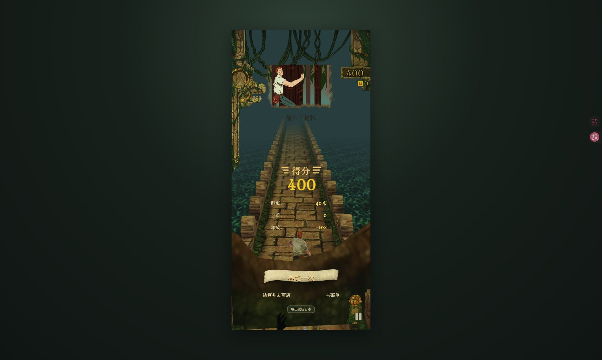
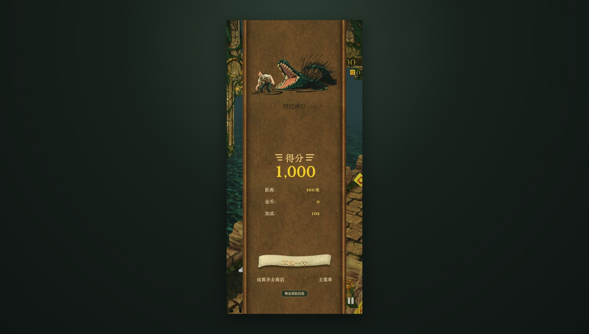
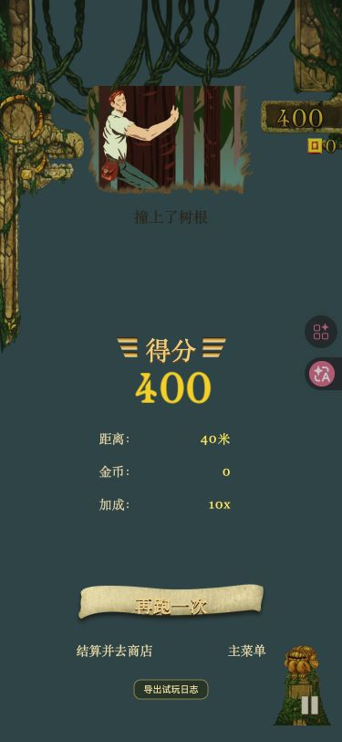
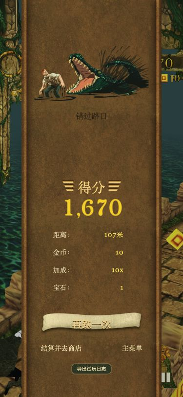

# 结算纸卷丢失：生产构建诊断与回归

## 根因

线上版本3d8ea89实际进入死亡结算后，`.scroll-paper` 的盒子为316.7×896，但计算背景URL是：

`https://malcolmyu.github.io/temple-run/assets/assets/ui/result-paper-tile.png` → **404**。

组件在行内自定义属性中提供相对URL，再在外部打包CSS里消费该变量。URL按CSS所在的assets目录解析，出现重复assets层。带`?release=`并非根因，资源本身也未漏发。

同一次复现的死亡插画 `assets/ui/deathIllustrationTree@2x.png` 已解码512×256且可见。用户提供截图上方也有死亡插画，因此没有把“插画也丢失”的推测当作已证实事实。网络面板捕获纸卷404；console错误列表为空，不能仅靠console无报错判定图片正常。

## 修复

GameOverOverlay在文档基准下解析绝对URL，然后直接设置纸卷行内backgroundImage，移除跨样式表消费的`--scroll-atlas`。插画、标题和重开按钮共用相同的资源解析方式，并通过现有optimizedAsset映射使用WebP发布副本。没有修改容器尺寸、碰撞、玩法或结算入账规则。

修复后请求：`/temple-run/assets/runtime/result-paper-tile.f1cc43df787d.webp` → **200 / image/webp**。死亡插画、标题、按钮图片也均200。数字仍使用其现有资源路径，全部成功解码。

证据页构建检查另修正为对固定审计提交执行git show后校验哈希，避免把新源码与旧版本快照混比。证据页仍审计b41ce82，未冒称已更新为新实现。

## 实际验证

- 线上旧版跑动至自然碰撞死亡，捕获网络响应、计算样式和图片解码尺寸；`tools/browser-result-assets.ts`检查失败，仅纸卷404。
- 本机生产构建从`/temple-run/?release=result-paper`加载，实际开始游戏、死亡结算，避免只在开发服务器验证。
- 桌面：纸卷316.7×896；375×812：286.9×812；背景与插画可见，指标落在纸卷内。
- 两种尺寸均点击“再跑一次”：进入playing，新runId，分数重置；再次死亡后点击“结算并去商店”：商店面板出现。
- 浏览器检查读取实际计算backgroundImage并fetch，而非只检查源码字符串或模拟Vue组件。修前失败、修后passed=true。
- typecheck、生产构建、资源校验、固定证据源校验、game-session与death-presentation测试通过。

手动浏览器回归编译：

```sh
./node_modules/.bin/esbuild tools/browser-result-assets.ts --bundle --format=iife --global-name=ResultAssetsAudit --outfile=/tmp/temple-result-audit.js
```

在实际生产结算页执行编译脚本后，等待`ResultAssetsAudit.inspectResultAssets()`并断言返回的`passed === true`。该检查必须在真实结算页运行，不能用空页面代替。

## 截图

截图分别来自实际失败回合，不同回合分数与死亡插画不同；不用于逐帧玩法对比。

|尺寸|修复前|修复后|
|---|---|---|
|桌面|||
|375×812|||
